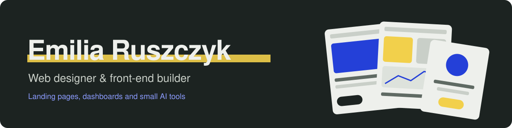
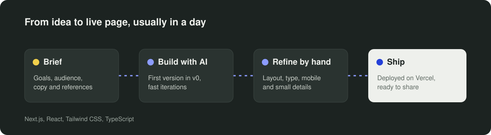
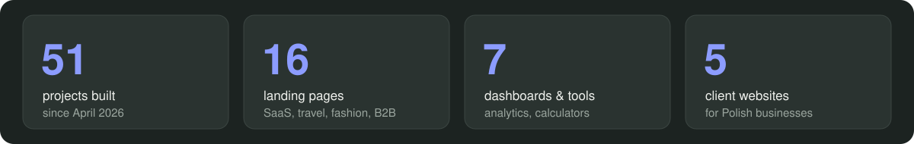

### I design landing pages that look finished, not generated.

I'm a **web designer and front-end builder** from Poland. I use AI tools like **v0** to get a first version fast, then refine layout, typography and mobile details by hand until the page feels like it was made for one specific brand. I build in **Polish and English**.

---

## ⚙️ How I work

---

## 📈 So far

- 🌐 **16 landing pages** for SaaS, travel, fashion, B2B and education brands
- 📊 **7 dashboards & tools**, from language analytics to a product configurator
- 🧩 **8 reusable components** like AI flashcards, an ROI calculator and social proof sections
- 🏢 **5 client websites** for Polish businesses

---

## 🚀 Featured work

<table>
<tr>
<td width="33%" valign="top">

### 📊 Dashboards
*Data people can actually read.*

- Project Panther dashboard
- Language Analytics Dashboard
- Oracle Hub dashboard
- Job application dashboard

</td>
<td width="33%" valign="top">

### 🏝️ Landing pages
*Built around one clear action.*

- Luxury Safari Lodge
- Luxury diving resort
- Luxury fashion
- SaaS and B2B pages

</td>
<td width="33%" valign="top">

### 🧩 Components
*Small pieces, carefully finished.*

- AI Flashcards
- ROI calculator
- Product configurator
- Social proof section

</td>
</tr>
</table>

👉 **See all 51 projects on my portfolio: [journey17x.github.io](https://journey17x.github.io)**

---

## 🧰 Tech I build with

**Front-end**: Next.js, React, TypeScript, Tailwind CSS, HTML & CSS  
**AI tools**: v0, Claude  
**Deploy & tools**: Vercel, GitHub

---

## 🧭 Currently

**Focused on**: landing pages for small businesses, portfolio sites, AI-powered components  
**Exploring**: interactive web experiences and design systems

---

## 🤝 Connect

> *Good pages don't need explaining. I try to build those.*
